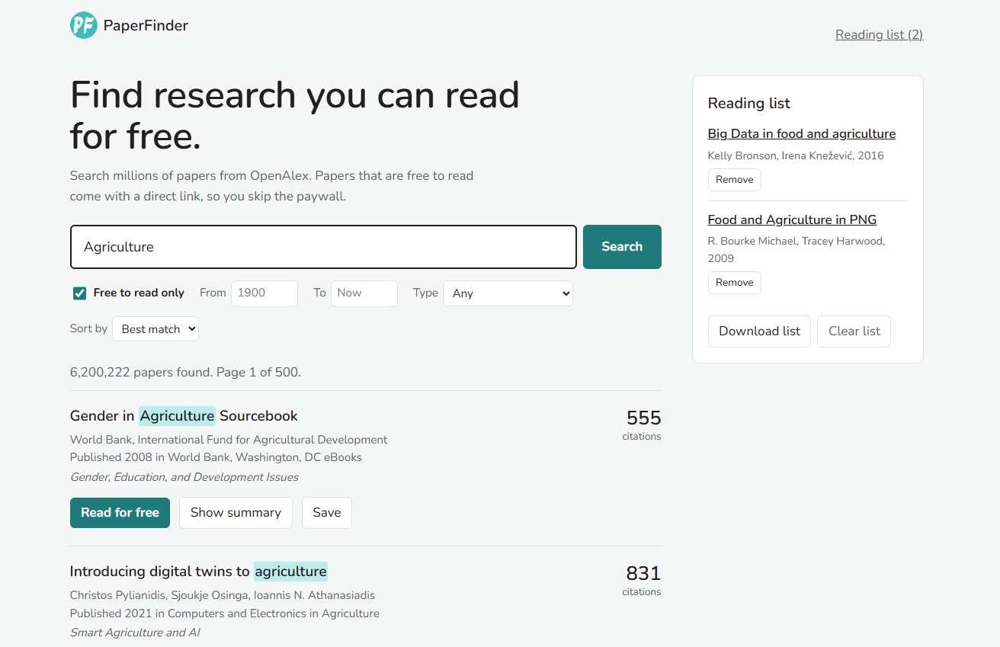
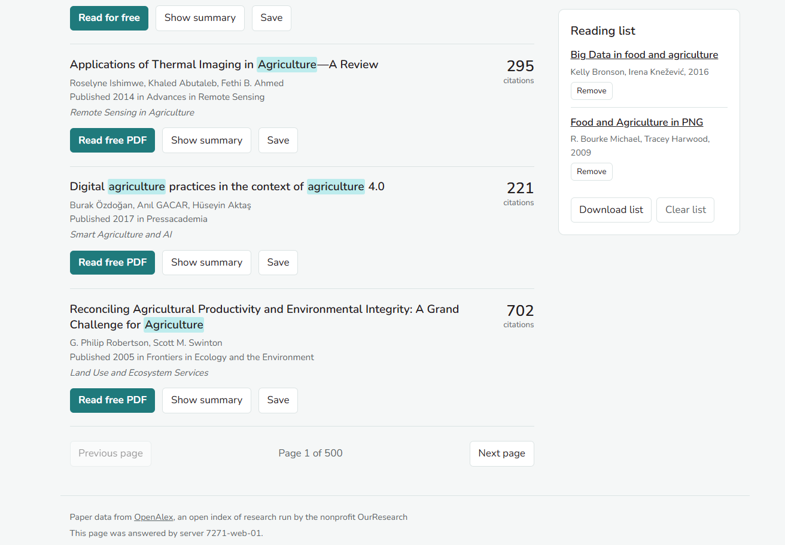

#  PaperFinder

PaperFinder helps students find research papers they can read for free.

- **Live app (through the load balancer):** https://www.ryang.tech/papers/
- **Demo video:** [add your link after recording]
- **Repository:** https://github.com/RyanGakire/paperfinder

**Screenshots:**

**Top of the page**



**Bottom of the page**



## Why I built it

Many students, including me, find a paper that looks perfect for an assignment, click on it, and hit a paywall. Finding research that is both reliable and free to read takes a lot of time. I built PaperFinder so students can search a topic and go straight to papers they can actually open, with a direct link to the free version.

## What you can do

- **Search** any topic with keywords, for example `mobile money Rwanda`.
- **See why a paper matched:** your search words are highlighted in each title.
- **Filter** the results by year range and by type (articles, reviews, books and chapters, preprints, theses), and turn "Free to read only" on or off.
- **Sort** by best match, most cited, or newest.
- **Read a paper's summary** without leaving the page.
- **Open the free version** with one click ("Read free PDF" or "Read for free").
- **Keep a reading list:** save papers, remove them, and download the list as a text file with references. The list stays in your browser, so no account is needed.
- **Page through results**, 20 papers at a time.
- **Share or refresh a search:** the search is kept in the address bar, so a refresh or a shared link shows the same results.

If something goes wrong, like a search that's too short, years in the wrong order, or OpenAlex being slow or down, the app shows a clear red message explaining what happened instead of crashing.

---

## How it works

```
 Browser
    |  https://www.ryang.tech/papers/
    v
 lb-01 (HAProxy) -- decrypts HTTPS, sends each request to the next server in turn
    |                         |
    v                         v
 web-01 (Nginx)          web-02 (Nginx)        -- /papers/ goes to the app
    |                         |
    v                         v
 Gunicorn + Flask app    Gunicorn + Flask app   -- port 5000, only reachable from the server itself
    |                         |
    +-----------+-------------+
                v
       OpenAlex API (api.openalex.org)
```

The browser only ever talks to our own server. The Flask app is the one that calls OpenAlex, so the API key stays on the server and never reaches the browser or GitHub.

| File | What it does |
| ---- | ------------ |
| `app.py` | Flask server: serves the page, checks the user's input, answers `/api/search` and `/api/health` |
| `openalex.py` | Calls OpenAlex, rebuilds abstracts, cleans each paper, caches results, turns errors into messages |
| `static/index.html`, `static/style.css`, `static/app.js` | The web page (plain HTML, CSS and JavaScript) |
| `tests/test_app.py` | 24 automatic tests that use fake OpenAlex answers |
| `deploy/setup_web_server.sh` | Installs or updates the app on a web server |
| `deploy/paperfinder.service` | Runs the app in the background and restarts it if it stops (systemd) |
| `deploy/nginx-paperfinder.conf` | Tells Nginx to send `/papers/` to the app |
| `deploy/haproxy.cfg` | The load balancer config on lb-01 |
| `.github/workflows/tests.yml` | Runs the tests on GitHub after every push |

---

## The API: OpenAlex

OpenAlex is an open catalogue of scholarly research, run by the nonprofit OurResearch. It provides information about academic works, authors, institutions, journals and research topics through a free and open API.

- Website: https://openalex.org
- API documentation: https://help.openalex.org/api/
- Endpoint used: `GET https://api.openalex.org/works`
- Data license: CC0 (free to use)

Parameters used: `search`, `filter` (`is_oa:true`, `publication_year`, `type`), `sort`, `per_page`, `page`, `select`, `api_key`.

OpenAlex can be used without an API key, but a free key gives a bigger daily limit. Get one at https://openalex.org/signup. After signing up, you must activate the key by clicking the link in the "*Activate your OpenAlex API key*" email. Until then, OpenAlex refuses the key.

> **The API key is not in this repository.** It's shared in the assignment submission comment. No login is needed to use the app.

---

## Run it on your own computer

You need Python 3.8 or newer and Git.

```bash
git clone https://github.com/RyanGakire/paperfinder.git
cd paperfinder
python3 -m venv venv
source venv/bin/activate          # on Windows Git Bash: source venv/Scripts/activate
pip install -r requirements.txt
cp .env.example .env              # then add your OpenAlex key to .env
python3 app.py
```

Open http://127.0.0.1:5000

### Run the tests

```bash
pip install -r requirements-dev.txt
python3 -m pytest -q
```

---

## Deployment

| Server | IP | Role |
| ------ | -- | ---- |
| 7271-web-01 | 52.56.224.223 | Nginx + PaperFinder |
| 7271-web-02 | 13.135.169.7 | Nginx + PaperFinder |
| 7271-lb-01 | 18.130.255.109 | HAProxy load balancer with HTTPS (`www.ryang.tech`) |

### 1. Web servers (done on web-01 and web-02)

```bash
ssh -i ~/.ssh/school ubuntu@SERVER_IP
sudo apt-get update && sudo apt-get install -y git
sudo git clone https://github.com/RyanGakire/paperfinder.git /opt/paperfinder
sudo /opt/paperfinder/deploy/setup_web_server.sh https://github.com/RyanGakire/paperfinder.git
```

What the script does:

1. Installs `git`, `nginx` and `python3-venv`.
2. Clones the code to `/opt/paperfinder` (or pulls the latest version if it's already there).
3. Creates a Python virtual environment and installs the packages from `requirements.txt`.
4. Creates `/opt/paperfinder/.env` from `.env.example` and makes it readable only by the app's user (`www-data`).
5. Installs `paperfinder.service`, so systemd runs the app with Gunicorn (2 workers) on `127.0.0.1:5000`, starts it when the server boots, and restarts it if it stops.
6. Adds one line to the existing Nginx site, `include snippets/paperfinder.conf;`. That sends `/papers/` to the app. Everything else Nginx already served (the home page, `/redirect_me`, the custom 404 page, the `X-Served-By` header) is left unchanged.
7. Tests the Nginx config, reloads Nginx, and calls `/papers/api/health` to confirm the app answers.

Then add the API key and restart the app:

```bash
sudo sed -i 's/^OPENALEX_API_KEY=.*/OPENALEX_API_KEY=YOUR_KEY/' /opt/paperfinder/.env
sudo systemctl restart paperfinder
```

The app only listens on `127.0.0.1`, so it can't be reached directly from the internet: every visitor has to go through Nginx on port 80. This also fits web-01's firewall, which only allows ports 22, 80 and 443. The app runs as the low-privilege `www-data` user instead of `root`, so a security problem in the app couldn't take over the whole server.

**To update after pushing changes**, run this on each server:

```bash
sudo git -C /opt/paperfinder pull
sudo /opt/paperfinder/deploy/setup_web_server.sh https://github.com/RyanGakire/paperfinder.git
```

### 2. Load balancer (lb-01)

The config is in [`deploy/haproxy.cfg`](deploy/haproxy.cfg).

- **Port 80:** redirects every visitor to HTTPS with a `301`.
- **Port 443:** decrypts HTTPS using a Let's Encrypt certificate for `www.ryang.tech` (SSL termination), adds `X-Forwarded-Proto: https`, and passes the request on.
- **Backend:** `balance roundrobin` sends requests to web-01 and web-02 in turn. `check` makes HAProxy stop sending traffic to a server that stops answering on port 80.

This config was already in place from my earlier load balancer and HTTPS projects, and it needed no change: HAProxy forwards every path, so `https://www.ryang.tech/papers/` reaches the app on both servers.

### 3. Testing the load balancer

Each answer from the app includes the name of the server that handled it. Asking the load balancer four times in a row:

```bash
$ for i in 1 2 3 4; do curl -s https://www.ryang.tech/papers/api/health; echo; done
{"api_key_set":true,"served_by":"7271-web-01","status":"ok"}
{"api_key_set":true,"served_by":"7271-web-02","status":"ok"}
{"api_key_set":true,"served_by":"7271-web-01","status":"ok"}
{"api_key_set":true,"served_by":"7271-web-02","status":"ok"}
```

The two servers take turns. In the app itself, the footer shows which server answered ("This page was answered by server 7271-web-01"), and it changes between searches.

**When one server goes down**, the site keeps working:

1. On web-01, stop its web server:
    ```bash
    sudo service nginx stop
    ```
2. Wait about 10 seconds for HAProxy to notice, then ask the load balancer again from your computer. Every request now goes to web-02:
    ```bash
    $ for i in 1 2 3 4; do curl -s https://www.ryang.tech/papers/api/health; echo; done
    {"api_key_set":true,"served_by":"7271-web-02","status":"ok"}
    {"api_key_set":true,"served_by":"7271-web-02","status":"ok"}
    {"api_key_set":true,"served_by":"7271-web-02","status":"ok"}
    {"api_key_set":true,"served_by":"7271-web-02","status":"ok"}
    ```
3. On web-01, start it again:
    ```bash
    sudo service nginx start
    ```
4. After about 10 seconds, the two servers take turns again:
    ```bash
    $ for i in 1 2 3 4; do curl -s https://www.ryang.tech/papers/api/health; echo; done
    {"api_key_set":true,"served_by":"7271-web-02","status":"ok"}
    {"api_key_set":true,"served_by":"7271-web-01","status":"ok"}
    {"api_key_set":true,"served_by":"7271-web-02","status":"ok"}
    {"api_key_set":true,"served_by":"7271-web-01","status":"ok"}
    ```

---

## Security and performance

- **API key kept secret:** stored only in `.env` on each server (`chmod 600`, owned by `www-data`). `.env` is in `.gitignore`, and the browser never sees the key. A test checks the key never appears in the app's replies.
- **Input checking:** the server checks every search setting (length, years, sort, type, page) and rejects anything unexpected with a clear message, before anything is sent to OpenAlex.
- **XSS protection:** all text from the API is added to the page with `textContent`, never as HTML. A strict `Content-Security-Policy` header only allows scripts from our own server.
- **Caching:** each server remembers search results for 10 minutes (`CACHE_SECONDS`). Repeated searches are instant and use less of the OpenAlex daily limit.
- **Timeouts and errors:** calls to OpenAlex give up after 10 seconds, and every failure (timeout, rate limit, bad key, server error) becomes a plain message for the user instead of a crash.
- **Automated tests:** 24 tests run on every push with GitHub Actions.

---

## Limitations

- The reading list only lives in the browser where it was saved. It doesn't follow you to another browser or device, since that would need user accounts.
- Whether a paper is free to read comes from OpenAlex's data, which can be out of date. A paper marked "No free version found" is occasionally available somewhere.
- HAProxy only checks whether port 80 answers. If the app stopped but Nginx kept running on a server, HAProxy would keep sending visitors there, and some requests would get an error until the app restarts.
- OpenAlex only allows paging through the first 10,000 results of a search (500 pages).

---

## Challenges and how I solved them

- **Keeping my earlier projects working.** web-01 and web-02 already serve "Holberton School" at `/` for my intranet project tasks. Instead of replacing that, I put the app under `/papers/` with a small Nginx snippet. The page uses relative links (`api/search`, `static/app.js`), so the same code works on my laptop at `/` and on the servers at `/papers/`.
- **Keeping the API key out of the browser.** A plain web page would have to put the key in JavaScript, where anyone can read it. A small Flask backend holds the key in `.env` and calls OpenAlex for the page.
- **Scrambled abstracts.** OpenAlex doesn't send abstracts as normal text. It sends each word with its positions, like `{"money": [1], "Mobile": [0]}`. I wrote `rebuild_abstract()` to put the words back in order so users can read the summary.
- **Typos that broke the code.** I typed the code myself, so I made small mistakes, like `self.items` instead of `self._items`, `indexof` instead of `indexOf`, and `api/search` without its first `/`. I learned to read the traceback from the bottom up and look for the line in my own file, which pointed straight to each mistake.
- **A misleading error message.** At one point the page said "Couldn't reach PaperFinder" even though the server was running fine. The real problem was a bug in my JavaScript, but the error was being hidden. Adding `console.error(error)` showed the real error and the exact line in the browser's Console.
- **Deployment errors on the servers.** My setup script failed three times because of small typos: `-m env` instead of `-m venv`, `paperfinder/conf` instead of `paperfinder.conf`, and `--acces-logfile` instead of `--access-logfile`. The last one showed up as a `502 Bad Gateway`. I used `systemctl status` and `journalctl -u paperfinder` to read the app's own errors on the server, fixed each typo on my laptop, pushed, and ran the script again.
- **Old Python on the servers.** The servers run Ubuntu 20.04 with Python 3.8, but the newest Flask needs 3.9. I pinned Flask 3.0, which still supports 3.8.
- **Rate limits.** OpenAlex limits how much each key can do per day, so I added a cache and a clear "too many searches" message instead of an error page.

---

## Credits

- [OpenAlex](https://openalex.org) by OurResearch, for the research data
- [Flask](https://flask.palletsprojects.com), [Requests](https://requests.readthedocs.io), [python-dotenv](https://github.com/theskumar/python-dotenv), [Gunicorn](https://gunicorn.org) and [pytest](https://pytest.org)
- [Nginx](https://nginx.org), [HAProxy](https://www.haproxy.org) and [Let's Encrypt](https://letsencrypt.org)
- Font: [Nunito](https://fonts.google.com/specimen/Nunito) from Google Fonts

## Author

- [RyanGakire](https://github.com/RyanGakire/)